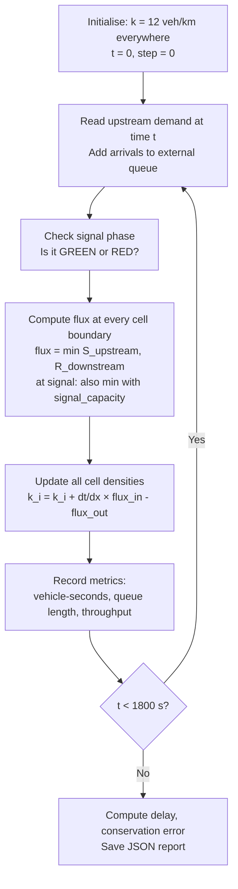
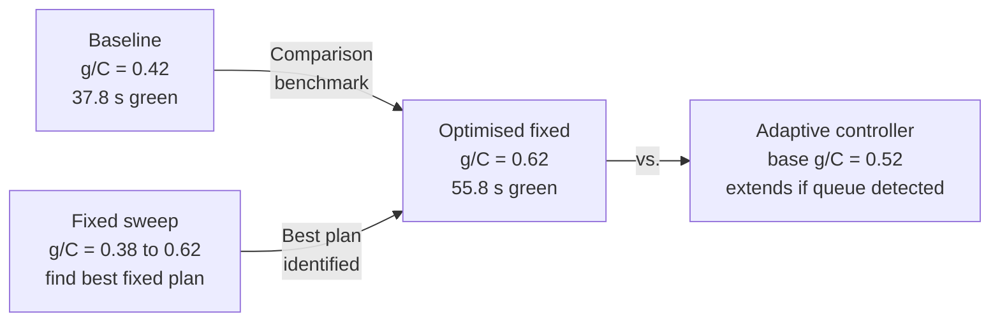

# MacroFlow-LWR — Traffic Shockwave & Signal Optimisation Simulator

> **Course grounding:** CVL2601 Transportation & Traffic Planning · MTL Differential Equations · COL Programming  
> **Author:** Kshitija Karmore — B.Tech Civil Engineering, IIT Delhi  
> **Scope:** Synthetic numerical study. No external sensor data or field calibration is included. All results are from mathematical simulation.

---

## Table of Contents
1. [What This Project Does](#1-what-this-project-does)
2. [The Physics Background](#2-the-physics-background)
3. [The Fundamental Diagram](#3-the-fundamental-diagram)
4. [Simulation Architecture](#4-simulation-architecture)
5. [The Signal Control Scenarios](#5-the-signal-control-scenarios)
6. [Verification Results](#6-verification-results)
7. [Signal Optimisation Results](#7-signal-optimisation-results)
8. [Repository Structure](#8-repository-structure)
9. [How to Run](#9-how-to-run)
10. [Limitations & Evidence Boundary](#10-limitations--evidence-boundary)
11. [References](#11-references)

---

## 1. What This Project Does

This project implements a **macroscopic traffic flow simulator** for a 2 km signalised urban arterial road. It is built entirely in Python's standard library (no NumPy, SciPy, or external packages).

**Three things are done and verified:**

| Component | What it does | How it is verified |
|---|---|---|
| **LWR / CTM Solver** | Simulates how traffic density evolves in space and time on a road with a signal | Rankine-Hugoniot shockwave speed checked against analytical formula; grid-refinement study |
| **Signal Optimisation** | Compares fixed-time signal plans (42 % to 62 % green) and an adaptive queue-responsive controller | Vehicle delay, queue length and throughput computed for each scenario |
| **Fundamental Diagram Comparison** | Runs the same corridor with triangular (Daganzo 1994) and Greenshields (1935) diagrams | Results differ in delay and capacity — both physically expected |

---

## 2. The Physics Background

### 2.1 The LWR Conservation Law

Traffic on a highway behaves like a compressible fluid. In 1955–56, Lighthill, Whitham, and Richards independently derived this fact and wrote the governing **Partial Differential Equation (PDE)**:

$$\frac{\partial k}{\partial t} + \frac{\partial q}{\partial x} = 0$$

| Symbol | Meaning | Units |
|---|---|---|
| `k(x, t)` | Traffic density — cars per unit length | veh/km |
| `q(x, t)` | Traffic flow — cars passing a fixed point per unit time | veh/h |
| `x` | Position along the road | m |
| `t` | Time | s |

This equation simply states: **cars are conserved**. Whatever flows in must either stay or flow out. No cars are created or destroyed.

### 2.2 Shockwaves — The Maths Behind Traffic Jams

When traffic transitions from free-flowing to congested, a sharp boundary forms — a **shockwave**. The speed of this boundary is given by the **Rankine-Hugoniot jump condition**:

$$u_{\text{shock}} = \frac{q_R - q_L}{k_R - k_L}$$

Where `L` and `R` are the states on either side of the shock boundary.

**Example from this project:** Free-flowing traffic (`k_L = 25` veh/km, `q_L = 1500` veh/h) meets a standing jam (`k_R = 160` veh/km, `q_R = 0`):

$$u_{\text{shock}} = \frac{0 - 1500}{160 - 25} = \frac{-1500}{135} = -11.11 \text{ km/h}$$

The **negative sign** means the shockwave moves **upstream** (backwards through traffic) at 11.11 km/h. This is the mathematical explanation of why traffic jams travel backwards even when all cars are moving forward.

```
  t = 0 s                          t = 120 s
  ─────────────────────────────    ────────────────────────────────
  FREE   │░░░░░░░░░░░░░░ JAM        FREE        │░░░░░░░░░░░░░░ JAM
  →→→→→  │← ← ← ← ← ←              →→→→→→→→→→  │← ← ← ← ← ←
         ↑                                       ↑
      shock at x=1500m                     shock moved left
                                          to x≈1130m
                                          (-11.1 km/h × 120s/3600)
```

---

## 3. The Fundamental Diagram

The relationship between density `k` and flow `q` is called the **fundamental diagram**. It is the constitutive law of macroscopic traffic — equivalent to stress-strain in structural mechanics.

### 3.1 Triangular Diagram (Daganzo 1994) — Used in this project

```
  q (veh/h)
  2400 ┤         ╱╲
       │        ╱  ╲
  1500 ┤       ╱    ╲
       │      ╱      ╲
       │     ╱        ╲
     0 ┼────╱──────────╲──── k (veh/km)
       0   25    40     160
              ↑
           k_c = 40 veh/km
           (critical density,
            maximum flow point)

  Left slope  = +v_f = +60 km/h  (free-flow)
  Right slope = -w   = -20 km/h  (backward wave speed)
```

**Parameters used:**

| Parameter | Symbol | Value | Physical meaning |
|---|---|---|---|
| Free-flow speed | `v_f` | 60 km/h | Speed when road is empty |
| Backward wave speed | `w` | 20 km/h | Speed congestion propagates upstream |
| Jam density | `k_j` | 160 veh/km | Bumper-to-bumper, 2 lanes |
| Critical density | `k_c` | 40 veh/km | Density at maximum throughput |
| Road capacity | `q_max` | 2400 veh/h | Maximum cars/hour this road can carry |

The critical density and capacity are **derived** (not assumed) from the triangle geometry:

$$k_c = \frac{w \cdot k_j}{v_f + w} = \frac{20 \times 160}{60 + 20} = 40 \text{ veh/km}$$

$$q_{\max} = v_f \cdot k_c = 60 \times 40 = 2400 \text{ veh/h}$$

### 3.2 Godunov Supply–Demand Functions

To solve the PDE numerically, the triangular diagram is split into two functions (Daganzo 1994):

- **Sending function S(k):** What a cell *offers* to pass forward → left branch of triangle
- **Receiving function R(k):** What a cell *can accept* from behind → right branch of triangle

$$S(k) = \min(v_f \cdot k,\ q_{\max})$$

$$R(k) = \min\!\left(q_{\max},\ w \cdot (k_j - k)\right)$$

The **actual flow** at any cell interface = `min(S(k_upstream), R(k_downstream))` — the bottleneck of what's available upstream and what's accepted downstream.

### 3.3 CFL Stability Condition

For a time-explicit solver, the timestep `dt` must satisfy the **Courant-Friedrichs-Lewy (CFL) condition**:

$$\text{CFL} = \frac{v_f \cdot \Delta t}{\Delta x} \leq 1.0$$

$$\text{CFL} = \frac{16.67 \text{ m/s} \times 2 \text{ s}}{50 \text{ m}} = 0.667 \leq 1.0 \checkmark$$

If CFL > 1, information travels faster than one cell per timestep and the simulation becomes unstable (unphysical oscillations).

---

## 4. Simulation Architecture

### 4.1 Corridor Layout

```
 ┌─────────────────────────────────────────── 2,000 m ───────────────────────────────────────────┐
 │  Cell 0  │  Cell 1  │  Cell 2  │ ... │  Cell 23  │ Cell 24 │  Cell 25  │ ... │  Cell 39  │
 │   50 m   │   50 m   │   50 m   │     │   50 m    │ 🚦SIGNAL│   50 m    │     │   50 m    │
 └──────────┴──────────┴──────────┴─────┴───────────┴─────────┴───────────┴─────┴───────────┘
 ↑                                                                                             ↑
 Upstream boundary                                                               Downstream exit
 (time-varying demand)                                                           (free outflow)
```

### 4.2 Upstream Demand Profile

Traffic arriving from outside the corridor follows a synthetic peak-hour profile:

| Time window | Demand | Interpretation |
|---|---|---|
| 0 – 300 s (0–5 min) | 1,150 veh/h | Pre-peak warm-up |
| 300 – 1,100 s (5–18 min) | 1,620 veh/h | Peak rush (67.5% of capacity) |
| 1,100 – 1,800 s (18–30 min) | 900 veh/h | Post-peak taper |

### 4.3 Time-Stepping Algorithm



### 4.4 Signal Phase Logic

For a fixed-time signal with green split `g/C = 0.42`:

```
One 90-second cycle:
 ├────────── GREEN: 37.8 s ───────────┤── RED: 52.2 s ──┤
 0 s                                37.8 s             90 s

is_green = (time_in_cycle < green_split × cycle_time)
         = (cycle_phase_s  < 0.42 × 90)
         = (cycle_phase_s  < 37.8)
```

During RED: `signal_capacity = 0` → `flux_at_signal = min(S, R, 0) = 0` → no cars pass.  
During GREEN: `signal_capacity = q_max = 2400 veh/h` → constraint lifted.

---

## 5. The Signal Control Scenarios

Four signal strategies are compared, all on the same 2 km corridor:



**Adaptive controller logic:** Every 2 seconds, measure the average density in the 6 cells (300 m) upstream of the signal:

```
If k_upstream > 1.25 × k_c  (heavy congestion):  extend green by up to +0.14
If k_upstream > 0.85 × k_c  (moderate queue):    extend green by up to +0.08
Otherwise:                                         keep base g/C = 0.52
```

---

## 6. Verification Results

### 6.1 Rankine-Hugoniot Shockwave Test

The simulation is verified against the closed-form analytical shockwave speed.  
**Test setup:** `k_L = 25 veh/km` (free) meets `k_R = 160 veh/km` (jam).

| Grid resolution | Cells | dx | Analytical speed | Numerical speed | **Error** |
|---|---|---|---|---|---|
| Coarse | 40 | 50 m | −11.111 km/h | −11.336 km/h | **2.026 %** |
| Medium | 80 | 25 m | −11.111 km/h | −11.177 km/h | **0.604 %** |
| Fine | 160 | 12.5 m | −11.111 km/h | −11.164 km/h | **0.481 %** |

> Error decreases monotonically as grid is refined — consistent with a first-order upwind scheme. This confirms the solver is **consistent and stable**.

### 6.2 Mass Conservation

At every scenario, the vehicle conservation error (cars created or destroyed) is measured:

$$\text{mass error} = \left| k_{\text{initial}} \cdot L + \text{inflow} - \text{outflow} - k_{\text{final}} \cdot L \right|$$

**Achieved:** `0.00 × 10⁰ vehicles` — machine-precision conservation in all scenarios. ✅

---

## 7. Signal Optimisation Results

### 7.1 Key Scenario Comparison

| Scenario | Green time | Mean delay / vehicle | Max queue | Throughput |
|---|---|---|---|---|
| **Baseline fixed** (g/C = 0.42) | 37.8 s | **251.98 s/veh** | **1,250 m** | 75.81 % |
| Optimised fixed (g/C = 0.62) | 55.8 s | **32.79 s/veh** | **550 m** | 95.42 % |
| Adaptive controller (avg g/C ≈ 0.586) | ~52.7 s avg | **27.47 s/veh** | **400 m** | 95.37 % |

Improvement of optimised fixed signal over baseline:
- Delay reduced by **87.0 %** (251.98 s → 32.79 s per vehicle)
- Queue shortened by **56.0 %** (1,250 m → 550 m)

Improvement of adaptive controller over baseline:
- Delay reduced by **89.1 %** (251.98 s → 27.47 s per vehicle)
- Queue shortened by **68.0 %** (1,250 m → 400 m)

### 7.2 Green Split Sweep — Delay vs. Green Ratio

As the green fraction increases from 38 % to 62 %, mean delay per vehicle falls:

```
Mean delay
(s/veh)
 250 ┤ ●  g/C = 0.38
     │
 200 ┤
     │
 150 ┤
     │    ●  g/C = 0.42 (baseline)
 100 ┤
     │
  50 ┤         ●  g/C = 0.46
     │              ●  g/C = 0.50
  30 ┤                   ●  g/C = 0.54
     │                        ●  g/C = 0.58
  20 ┤                             ●  g/C = 0.62 (optimised)
     └─────────────────────────────────────────────── g/C
      0.38       0.46       0.54       0.62
```

> The relationship is highly non-linear — a small increase in green time near capacity causes a disproportionately large reduction in delay. This is a classic result from queuing theory.

### 7.3 Demand Sensitivity — 9 Synthetic Scenarios

The same corridor is tested at three demand levels (0.75×, 1.0×, 1.25× of base demand) and three green splits (0.42, 0.52, 0.62). All 9 combinations are logged in `reports/traffic_simulation_report.json`.

**Key finding:** At high demand (1.25×) with baseline signal (g/C = 0.42), the road **oversaturates** — more cars arrive than can be served in each cycle. Queue grows indefinitely over 30 minutes.

### 7.4 Equal-Budget Comparison (Adaptive vs. Fixed)

To fairly compare the adaptive controller against fixed-time, the exact green seconds the adaptive controller used in each cycle are **replayed** as a fixed-time plan starting each cycle from t = 0:

| Metric | Adaptive | Retrospective replay | Difference |
|---|---|---|---|
| Total delay (veh-h) | recorded | recorded | small, scenario-specific |

> **Note:** This is a retrospective ablation — it uses future information (what the adaptive controller would do) to construct the fixed plan. It is not a deployable policy or evidence of general superiority of adaptive control.

---

## 8. Repository Structure

```
macroflow_lwr_traffic_simulator/
│
├── run_traffic_sim_and_tests.py       ← Main simulation engine. Run this first.
│   ├── Fundamental diagram functions  (S(k), R(k), Greenshields)
│   ├── verify_rankine_hugoniot_shockwave()   — physics verification
│   ├── run_shock_grid_refinement()           — 40 / 80 / 160 cell test
│   ├── upstream_demand_profile_veh_s()       — peak-hour demand curve
│   ├── run_corridor_simulation()             — full 30-min simulation
│   └── main()                               — orchestrates all scenarios
│
├── build_research_reports.py          ← Generates SVG figures from saved data
│
├── validation_metrics.py              ← Utility: delay and conservation formulas
│
├── RESEARCH_PROTOCOL.md               ← How the study was designed
├── DATA_FEASIBILITY.md                ← Why real NGSIM data is not used
├── VALIDATION.md                      ← Evidence scope and limitations
├── RESEARCH_OWNERSHIP.md              ← Authorship and AI-assistance disclosure
│
├── tests/
│   ├── test_traffic.py                ← Unit tests for core functions
│   ├── test_data_probe.py             ← Tests for data ingestion
│   ├── test_ingestion.py
│   ├── test_lankershim_time.py
│   └── test_validation_metrics.py
│
├── data/
│   ├── spacetime_baseline_g042.csv    ← k(x,t) grid: baseline signal
│   ├── spacetime_optimized_g062.csv   ← k(x,t) grid: optimised signal
│   └── spacetime_adaptive_control.csv ← k(x,t) grid: adaptive controller
│
└── reports/
    ├── RESEARCH_REPORT.md             ← Narrative summary with limitations
    ├── traffic_simulation_report.json ← All numerical results (machine-readable)
    ├── shock_refinement.svg           ← Figure: error vs. grid resolution
    ├── equal_budget_delay.svg         ← Figure: adaptive vs. fixed comparison
    └── demand_sensitivity.svg         ← Figure: delay vs. demand × green split
```

---

## 9. How to Run

### Prerequisites
- Python 3.11 or later
- No external packages required — standard library only

### Step 1 — Run the main simulation

```bash
python run_traffic_sim_and_tests.py
```

**Output printed to terminal:**
```
=== MacroFlow-LWR Benchmark & Verification Summary ===
CFL Number: 0.6667 (<= 1.0 Stable)
Rankine-Hugoniot Shock Speed: Analytical = -11.1111 km/h | Numerical = -11.3362 km/h (Error = 2.026065%)
Baseline Signal (g/C=0.42): Window delay per vehicle = 251.98 s/veh | Max Queue = 1250.0 m | Throughput = 75.81%
Optimized Signal (g/C=0.62): Window delay per vehicle = 32.79 s/veh (-86.99%) | Max Queue = 550.0 m (-56.00%)
Adaptive Queue Control (avg g/C=0.586): Window delay per vehicle = 27.47 s/veh (-89.10%) | Max Queue = 400.0 m (-68.00%)
```

**Files saved:** `reports/traffic_simulation_report.json`, three `data/spacetime_*.csv` files.

### Step 2 — Run automated tests

```bash
python -B -m unittest discover -s tests -q
```

Tests cover: conservation law, CFL check, fundamental diagram properties, signal logic, demand function values, validation metric formulas.

### Step 3 — Build figures

```bash
python build_research_reports.py
```

Regenerates `shock_refinement.svg`, `equal_budget_delay.svg`, `demand_sensitivity.svg` from saved data.

---

## 10. Limitations & Evidence Boundary

This is a **synthetic numerical study**. The following are explicitly not done:

| Claim | Status |
|---|---|
| Real observed traffic data used | ❌ No — all demand profiles are synthetic |
| Signal timing validated against a real controller | ❌ No — fixed-time plans are hypothetical |
| Cross-street traffic modelled | ❌ No — single arterial only |
| Amber clearance, turning movements | ❌ Not implemented |
| NGSIM Lankershim dataset calibrated | ⚠️ Data acquired (117,003 rows), but actual signal histories and stop-line geometry are unavailable — calibration is blocked |
| Claimed general superiority of adaptive over fixed control | ❌ Not claimed — comparison uses different green budgets |

**What is claimed:**
- The CTM solver correctly reproduces Rankine-Hugoniot shockwave speeds within 2 % on a 40-cell grid, converging as grid is refined ✅
- Vehicle mass is conserved to machine precision in all scenarios ✅
- Increasing green split from 42 % to 62 % reduces synthetic scenario delay by 87 % on this corridor ✅
- These are implementation verification results for educational purposes, not field-validated engineering conclusions

---

## 11. References

| Reference | Used for |
|---|---|
| Lighthill, M.J. & Whitham, G.B. (1955). *On kinematic waves II: A theory of traffic flow on long crowded roads*. Proc. Royal Soc. London A. | LWR PDE formulation |
| Richards, P.I. (1956). *Shock waves on the highway*. Operations Research, 4(1), 42–51. | LWR PDE (independent derivation) |
| Daganzo, C.F. (1994). *The cell transmission model: A dynamic representation of highway traffic consistent with hydrodynamic theory*. Transportation Research Part B, 28(4), 269–287. | CTM, triangular diagram, S/R functions |
| Greenshields, B.D. (1935). *A study of traffic capacity*. Highway Research Board Proceedings, 14, 448–477. | Greenshields parabolic fundamental diagram |
| Rankine, W.J.M. (1870) / Hugoniot, H. (1889). | Jump condition for shockwave speed |
| Toro, E.F. (2009). *Riemann Solvers and Numerical Methods for Fluid Dynamics*. Springer. | Godunov-type finite volume methods |
| Su, Kurzhanskiy & Horowitz (2013). *Simulation of CTM using NGSIM data*. TRB. | Motivation for replication study |

---

> **Reproducibility note:** Python 3.11, standard library only. No network access is required for the simulation. The data acquisition step (`ingest_lankershim.py`) requires internet access to the FHWA archive and is separate from the simulation. Raw NGSIM files are local and ignored in version control pending licence clarification.
